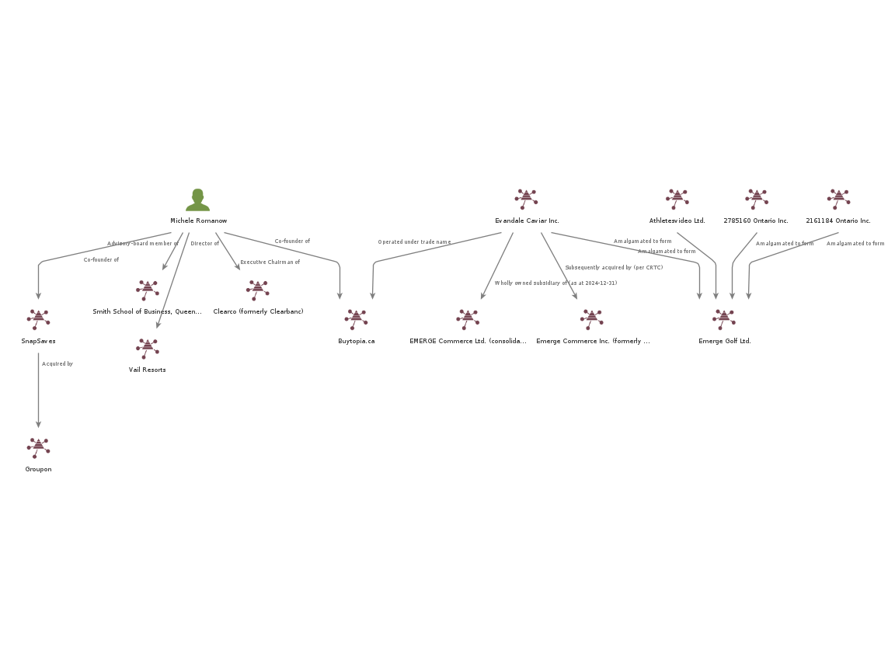
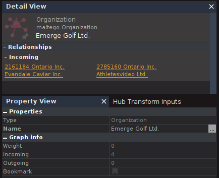
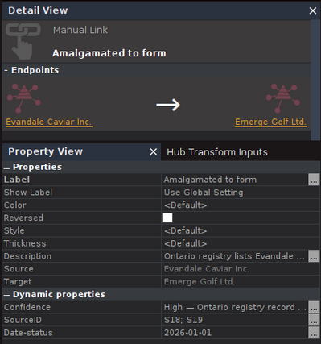

# Project Maple — Public-Source OSINT & Business Network Analysis

> A Canadian OSINT case study mapping selected professional relationships and the corporate history surrounding Buytopia.ca.

## Research question

What business affiliations, acquisitions, and corporate changes connected to Michele Romanow and selected Canadian businesses can be corroborated from open sources—and what remains uncertain?

This is a scoped portfolio exercise, not a comprehensive biography or an allegation of wrongdoing. It focuses on public professional and corporate information.

## Method

1. **Collect:** institutional biographies, company disclosures, public-company filings, regulator notices, corporate registries, and reporting.
2. **Extract:** record discrete claims with unique IDs and supporting source references.
3. **Reconcile:** compare dates, role descriptions, legal names, and conflicting disclosures.
4. **Resolve entities:** distinguish people, legal corporations, trade names, brands, and successor corporations.
5. **Visualize:** convert selected claims into directed relationships for Maltego, retaining source IDs, dates, confidence, and caveats.

The accompanying workbook contains the source register, claim register, claim-reconciliation worksheet, review summary, and Maltego edge candidates. Two CSV files contain the selected person-to-organization and organization-to-organization relationships.

## Findings, ambiguities, and how they were handled

| Issue | What the sources show | Treatment in this project |
|---|---|---|
| **Buytopia launch and founder dates** | Queen's reports a 2010 website launch; Vail Resorts gives Romanow's co-founder period as 2011–2014; a 2018 CSE filing says she founded Buytopia.ca in February 2011 and remained a partner. | Treat launch, co-founder period, and later partnership wording as different claims. Do not call either date the legal incorporation date or assume operational departure ended every ownership interest. |
| **Buytopia.ca's legal entity** | TICO identifies Evandale Caviar Inc. with the trade names Buytopia.ca / wagjag.com. EMERGE's audited 2024 statements identify Evandale o/a Buytopia.ca as a wholly owned subsidiary at December 31, 2024. | Represent Evandale Caviar Inc. and Buytopia.ca as separate nodes connected by an “operated under trade name” relationship. |
| **Acquisition versus amalgamation** | The CRTC describes Evandale as subsequently acquired by “Emerge Commerce Inc.”; Ontario registry records show four corporations amalgamated to form Emerge Golf Ltd. on January 1, 2026. | Use “acquired by” only when attributed to the CRTC account; use “amalgamated to form” for the four Ontario predecessor links. Keep “Emerge Commerce Inc.” and “EMERGE Commerce Ltd.” distinct pending evidence of legal-name continuity. |
| **Q1 2026 disclosure discrepancy** | EMERGE's interim statements still list Evandale, Athletesvideo, and 2161184 Ontario Inc. as wholly owned subsidiaries, but do not list Emerge Golf Ltd. or 2785160 Ontario Inc. The Ontario registry records the January 1, 2026 amalgamation. | Record an unresolved discrepancy. The interim statements are unaudited and were not auditor-reviewed. Do not infer why the subsidiary list differs or draw a new parent edge from it. |
| **buytopia brands Corp.** | A federal corporation with that name (no. 1701500-3; CBCA date shown as May 22, 2025) appears in Corporations Canada and Canada Business Registries. No reviewed source connects it to historical Buytopia.ca or Evandale. | Treat the matching registry results as one underlying federal record, not independent corroboration. Keep the company as an unlinked lead and exclude it from the graph. |
| **Trademark search** | Searches of the Canadian Trademarks Database did not locate a matching Buytopia / Buytopia.ca record. | Record the unsuccessful search as inconclusive; it does not establish that no unregistered brand or other rights existed. |
| **Other role and source conflicts** | Sources differ on some current/former roles and founder descriptions. Athena North's website did not establish its founding timeline; the Goldie nightclub investment was supported only by a low-confidence source in the reviewed set. | Prefer dated filings and relevant institutional/company sources. Hold or exclude uncertain edges. Wikipedia is lead-generation only; the CBC profile was not directly reviewed and is not relied upon. |

The central analytical discipline is to distinguish **what a source states**, **what can be corroborated**, and **what remains unresolved**. An edge represents a sourced relationship, not an allegation or a conclusion about conduct.

## Maltego visualisation

The three figures below are intended to document the graph at different levels: the complete network, the 2026 amalgamation relationships, and the source evidence behind an individual link.

### 1. Complete network

### 2. Emerge Golf Ltd. amalgamation

### 3. Relationship evidence

## Sources consulted

Source IDs correspond to the workbook's **Source Register**. The register records source type, date, URL, supported claims, limitations, assessment, and review status.

**Institutional, corporate, regulatory, and registry sources**

- **S01** — [Smith School of Business: Michele Romanow profile](https://smith.queensu.ca/about/advisory_board/Michele_Romanow.php)
- **S04** — [Vail Resorts: Leadership team](https://www.vailresorts.com/about-us/leadership-teams/)
- **S05** — [Vail Resorts: 2025 proxy statement](https://investors.vailresorts.com/static-files/a00ca071-3ce0-4eb9-8045-231129a2639a)
- **S06** — [Vail Resorts: 2025 annual-meeting voting results (Form 8-K)](https://investors.vailresorts.com/static-files/a62ca1e4-6ef0-4997-9e06-3307d077f269)
- **S08** — [EMERGE Commerce: 2020 corporate release](https://www.emerge-commerce.com/news/News/news-details/2020/Emerge-Commerce-Ltd.-formerly-Aumento-Capital-VII-Corporation-Closes-Reverse-Takeover-Transaction)
- **S09** — [Canadian Entrepreneurship Initiative: About Us](https://canadianentrepreneurship.ca/about-us)
- **S10** — [Canadian Entrepreneurship Initiative: 2017 launch press release](https://static1.squarespace.com/static/593cd2dcf5e231c052331f1e/t/60c0e1ddab80500e095d2b76/1623253470140/CEI%2BPress%2BRelease%2B2017.docx.pdf)
- **S12** — [Travel Industry Council of Ontario: former-registrants notice (June 27, 2024)](https://tico.ca/news/press-releases/741-june-27-2024-tico-releases-list-13-former-registrants-who-can-claim-security-deposit-returns.html)
- **S13** — [CRTC: Notice of Violation (April 23, 2019; updated June 18, 2020)](https://crtc.gc.ca/eng/archive/2019/vt190423.htm)
- **S15** — [EMERGE Commerce: audited 2024 and 2023 consolidated financial statements](https://s26.q4cdn.com/499705092/files/doc_financials/2025/q1/FS-Dec-31-2024-audited.pdf)
- **S16** — [Corporations Canada: buytopia brands Corp. corporate details](https://ised-isde.canada.ca/cc/lgcy/fdrlCrpDtls.html?p=0&corpId=17015003&crpNm=buytopia&crpNmbr=&bsNmbr=&cProv=&cStatus=&cAct=)
- **S18** — [Ontario Business Registry](https://www.appmybizaccount.gov.on.ca/onbis/): Emerge Golf Ltd. amalgamation profile (registry details captured during this project)
- **S19** — [Ontario Business Registry: Evandale Caviar Inc., OCN 2180000](https://www.appmybizaccount.gov.on.ca/onbis/corporations/viewInstance/view.pub?id=280aa9d4fbca6577ccb365bb8f57e85a4dbd3ceccd1ea1149bec70cec159d204&_timestamp=3524230625747679)
- **S20** — EMERGE Commerce Ltd., *Condensed Consolidated Interim Financial Statements for the three months ended March 31, 2026*, Note 2(f), p. 8 (PDF reviewed; unaudited and not auditor-reviewed).

**Reporting, institutional features, and issuer disclosures**

- **S07** — [TechCrunch: Groupon's acquisition of SnapSaves (October 2, 2014)](https://techcrunch.com/2014/10/02/after-quietly-acquiring-snapsaves-groupon-launches-snap-paying-you-to-shop/)
- **S11** — [Simon Fraser University, WWEST: Episode 56 — Michele Romanow](https://www.sfu.ca/wwest/projects/best-of-the-WWEST/episode-56-michele-romanow.html)
- **S14** — [Queen's University, Smith School of Business: “Dragon Lessons” (Summer 2016)](https://smith.queensu.ca/magazine/issues/summer-2016/profiles/dragon-lessons.php)
- **S17** — [Canadian Securities Exchange: Block X Capital Corp. Form 2A Listing Statement (January 23, 2018)](https://webfiles.thecse.com/0216v11_CSE_Form_2A_-_Listing_Statement_7_Jan_23_2018_Conformed.pdf)

**Lead-only / not relied on for findings**

- **S02** — [Wikipedia: Michele Romanow](https://en.wikipedia.org/wiki/Michele_Romanow) — used only to identify leads, not as evidence for material claims.
- **S03** — [CBC Dragons' Den: Michele Romanow profile](https://www.cbc.ca/dragonsden/dragons/michele-romanow) — direct review was not completed during this research pass; not relied on for findings.

## Repository contents

- `Project_Maple_Source_Register.xlsx` — source and claim registers, reconciliation, review summary, and edge candidates.
- `Project_Maple_Person_Relationships.csv` — selected person-to-organization edges.
- `Project_Maple_Organization_Relationships.csv` — selected organization-to-organization edges.
- `screenshots/complete-network.png` — complete Maltego network.
- `screenshots/organization-detail-view.png` — close-up of the four predecessor-to-successor relationships.
- `screenshots/link-detail-view.png` — selected relationship and its supporting source/date details.

## Scope and limitations

The project uses public professional and corporate information. It does not examine private life, make allegations, or claim to be a comprehensive background investigation. Registry details for S18 were transcribed from the Ontario Business Registry profile captured during the project. S20 is identified by document title and page because the working copy was supplied as a PDF. The map is a selective visualization; the workbook remains the detailed audit trail.

## Licence

**Recommended: CC BY 4.0 for original project documentation, analysis notes, and diagrams.** MIT is primarily a software licence and is not the best fit for this research repository. If original scripts or code are added later, those may be separately licensed under MIT.

Third-party source documents, logos, trademarks, and other material remain subject to their owners' rights and terms. The project licence does not relicense or grant permission to redistribute third-party material. See [Creative Commons Attribution 4.0 International](https://creativecommons.org/licenses/by/4.0/).
